# SHARAY: An Evidence-First Security Assessment Platform

**A technical research paper on the architecture, features, and verification model of SHARAY**

Author of SHARAY: Shardul Chaulagain · <https://shardulchaulagain.com>
Paper compiled from a full read of the codebase at repository state `main`.

---

## Abstract

SHARAY is a local-first, defensive security-assessment platform and penetration-testing
workspace. It is built around one uncompromising rule: **no verified evidence → no confirmed
vulnerability.** Where most scanners emit candidates from pattern matches on banners and
response snippets, SHARAY treats every candidate as a *hypothesis* and only promotes it to
"confirmed" after a cold, deterministic re-execution with a negative-control canary, or an
isolated executable proof. Around that verification core it wires a ten-stage assessment
pipeline, a rootless-container execution sandbox with single-destination egress locking,
a cryptographically hash-linked audit ledger, protocol-accurate reporting, and an interactive
human-in-the-loop operator console. This paper walks the whole system — process model, data
model, the scope-authorization boundary, each scanner and worker, the verification gate, the
AI reasoning layer, reporting, and the web UI — with the actual code that implements each part,
then states plainly what SHARAY does *not* do.

---

## 1. Introduction and motivation

Automated web scanners are notorious for false positives: a `Server: nginx` header becomes a
"vulnerable nginx"; a reflected string becomes "XSS"; a 200 response to `/.git/HEAD` becomes
"source code disclosure" without anyone confirming the bytes. The cost is real — analyst hours
burned triaging noise, and worse, *missed* real issues drowned in it.

SHARAY's thesis is that a finding is only worth reporting if it can be **reproduced on demand**.
The platform's design directive is explicit (it is encoded throughout the code and tests):

> A finding is a hypothesis until a cold replay proves it.
> — `packages/scanner_adapters/reproducer.py`

Everything else in SHARAY — the sandbox, the scope boundary, the audit ledger, the report
partitioning between *verified vulnerabilities* and *hardening posture* — exists to make that
rule enforceable and auditable.

The product is named SHARAY; the Python package tree is historically rooted at `aegis/` (the
backend) with a thin `sharay/` launcher on top. The two names refer to the same system.

---

## 2. System architecture

### 2.1 Process model

SHARAY runs as a small set of cooperating local processes, never a cloud service:

```
                 ┌────────────────────────────┐
   Desktop       │  python -m sharay desktop   │  (native pywebview window)
   window ◄──────┤   └─ spawns: aegis serve     │
                 └──────────────┬──────────────┘
                                │ stdin lifecycle pipe
                 ┌──────────────▼──────────────┐
  Next.js  ◄─────┤  FastAPI app  (aegis.api)    │  127.0.0.1:8765, loopback only
  static UI      │   └─ supervises: worker proc │
                 └──────────────┬──────────────┘
                                │ durable SQLite queue
                 ┌──────────────▼──────────────┐
                 │  aegis.worker  (one process) │  bounded, flock-serialized
                 │   └─ scanner adapters        │
                 │       └─ rootless container   │  podman/docker, egress-locked
                 └─────────────────────────────┘
```

The launcher `sharay/__main__.py` adds a `refresh` command and otherwise delegates to
`aegis/__main__.py`, which is the real entry point. `aegis.__main__.desktop()` builds the
frontend-check, spawns `aegis serve` as a child bound to the parent's stdin (so the API dies
with the window), waits for `/api/v1/health/ready`, then opens either a native `webview` window
or the system browser:

```python
# aegis/__main__.py — the parent/child lifecycle that ties the API to the window
process = subprocess.Popen(
    [sys.executable, "-m", "aegis", "serve", "--parent-stdin"],
    cwd=ROOT, env=environment, stdin=subprocess.PIPE, start_new_session=True,
)
...
window.events.closing += stop_api          # Cocoa Quit runs teardown synchronously
webview.start(debug=False, private_mode=True)
```

The server itself binds **only to loopback** and disables access logging:

```python
# aegis/__main__.py :: serve()
server = uvicorn.Server(uvicorn.Config(
    create_app(settings), host="127.0.0.1", port=settings.port,
    access_log=False, log_level="warning", timeout_graceful_shutdown=10,
))
```

The worker is a *single* process guarded by an advisory `flock`, with hard OS resource limits
so a runaway scan cannot exhaust the host:

```python
# aegis/worker.py :: main()
resource.setrlimit(resource.RLIMIT_CORE, (0, 0))        # no core dumps
resource.setrlimit(resource.RLIMIT_NOFILE, (2048, 2048))
resource.setrlimit(resource.RLIMIT_CPU, (7200, 7200))   # per-worker CPU ceiling
with (settings.data_dir / "worker.lock").open("a") as lock:
    fcntl.flock(lock, fcntl.LOCK_EX | fcntl.LOCK_NB)    # exactly one worker per DB
```

### 2.2 Run modes

`python -m sharay …` exposes (see `aegis/__main__.py`):

| Command | Purpose |
| --- | --- |
| `desktop` (default) | Native window + API + worker |
| `desktop --browser` | Same, but opens the system browser |
| `serve` | Headless loopback API + worker (team / CI nodes) |
| `init-owner` | Provision the first owner account (no default credentials exist) |
| `issue-recovery` / `reset-password` | Local-OS single-use account recovery |
| `migrate` | Apply forward-only Alembic migrations |
| `backup` / `restore` | Consistent private DB snapshots |
| `preflight` | Report scanner availability without running anything |
| `scan` / `probe` / `status` / `findings` | CLI automation (`aegis/cli.py`) |

### 2.3 Data model

All state lives in one private SQLite database (`.aegis/aegis.db`, mode `0700`/`0600`, WAL,
foreign keys on). The schema (`aegis/models.py`) is deliberately small and explicit:

- **Organization / User / SessionRecord / LoginAttempt / RecoveryToken** — multi-tenant RBAC,
  opaque server-side sessions, brute-force lockout, local recovery.
- **Project / Target** — a target carries its `scope` JSON, a monotonically increasing
  `scope_version`, and a `verification_status` that gates execution.
- **Assessment** — one scan run, with a *frozen* `scope_snapshot`, a `profile`, a `status`
  state machine, an `idempotency_key` unique per org, and a `retest_of` back-reference.
- **Observation / Finding / FindingEvidence / FindingHistory** — raw evidence, de-duplicated
  findings (unique on `(target_id, fingerprint)`), per-assessment evidence snapshots with their
  own hash, and an append-only status history.
- **AuditEvent** — the hash-linked ledger (Section 9).
- **OriginCooldown** — durable per-origin request pacing that survives restarts (Section 6.4).

The database is created and migrated through `aegis/database.py`, which refuses symlinked data
directories and clamps file permissions after every migration.

---

## 3. The authorization boundary: scope as a typed contract

This is the first and most important safety layer. Before any byte leaves the machine, the
target URL must pass an independently-checked scope policy. The policy is a strict Pydantic
model that *forbids* unknown fields and pins every dangerous knob to a safe literal
(`packages/security_policies/__init__.py`):

```python
class ScopePolicy(BaseModel):
    model_config = ConfigDict(extra="forbid")
    hosts: list[StrictString]            = Field(min_length=1, max_length=32)
    allowed_origins: list[StrictString]  = Field(min_length=1, max_length=64)
    allowed_paths: list[StrictString]    = Field(default_factory=lambda: ["/"], ...)
    excluded_paths: list[StrictString]   = Field(default_factory=list, max_length=32)
    allowed_cidrs: list[StrictString]    = Field(default_factory=list, max_length=32)
    authenticated: Literal[False] = False         # authenticated testing is off by contract
    credential_refs: list[StrictString] = Field(default_factory=list, max_length=0)
    request_rate: Annotated[float, Field(gt=0, le=5000)] = 1
    max_concurrency: Annotated[int, Field(ge=1, le=5)]   = 1
    starts_at: datetime
    expires_at: datetime
    intrusive: Literal[False] = False
    approval_required: Literal[True] = True
```

A scope cannot last longer than 24 hours, every origin must map to an explicitly authorized
host, and literal origins must fall inside the approved CIDRs:

```python
@model_validator(mode="after")
def coherent(self):
    if (self.expires_at - self.starts_at).total_seconds() > 86400:
        raise ValueError("Scopes have a maximum duration of 24 hours.")
    for origin in self.allowed_origins:
        host = urlsplit(origin).hostname
        if host not in self.hosts:
            raise ValueError("Every origin must have an explicitly authorized host.")
```

URL normalization (`normalize_url`) is paranoid on purpose — it rejects credentials in URLs,
query strings and fragments, non-canonical authorities, encoded path separators (`%2f`, `%5c`),
semicolon path parameters, traversal segments, and control characters, so that what the policy
checks is exactly what the socket will request.

**The execution boundary is checked separately from registration.** `check_execution_url`
decides *whether a URL may actually be contacted right now*:

```python
def check_execution_url(scope, url, *, owned=False) -> Destination:
    destination = check_url(policy, url)                 # origin/path/time window
    required_cidr = {"127.0.0.1": "127.0.0.1/32", "::1": "::1/128"}.get(destination.host)
    if required_cidr is not None:                        # loopback laboratory
        if required_cidr not in policy.allowed_cidrs:
            raise PolicyError("… requires explicit 127.0.0.1/32 approval.")
        return destination
    if not owned:                                        # live target → need ownership
        raise PolicyError("Live execution requires verified target ownership …")
    literal = ipaddress.ip_address(destination.host)     # SSRF guard, earliest point
    if (literal.is_private or literal.is_loopback or literal.is_link_local
            or literal.is_multicast or literal.is_reserved or not literal.is_global):
        raise PolicyError("Live targets must be public addresses …")
```

A loopback lab needs the exact `/32` approved; a live target needs operator ownership
(Section 10). Hostnames are not resolved here — resolution is deferred to execution so that
viewing and creating assessments stays deterministic and side-effect-free.

### 3.1 DNS pinning and the SSRF trap

At execution time the host is resolved **once** and pinned, and the whole answer set is refused
if *any* address is non-public — which defeats split-horizon DNS replies that try to slip an
internal IP past the allowlist:

```python
def resolve_pinned(host, resolver=None) -> str:
    res = ResolverService(...).resolve(TargetNormaliser.scrub(host))
    return res.pinned_ip          # one IP; everything else (incl. DNS) is dropped downstream
    # raises PolicyError on SSRF_REFUSED
```

That single pinned IP becomes the only destination the container egress firewall will allow
(Section 5).

**In the UI** this contract is surfaced before any scan runs. The operator fills a scope form
(Figure 4), and SHARAY renders the *exact, reproducible* resolved scope for review
(Figure 6) — allowed origins, hosts/IP policy, included/excluded paths, test categories, rate
and concurrency ceilings, validity window, and the fixed emergency-stop conditions — before a
single request is permitted.

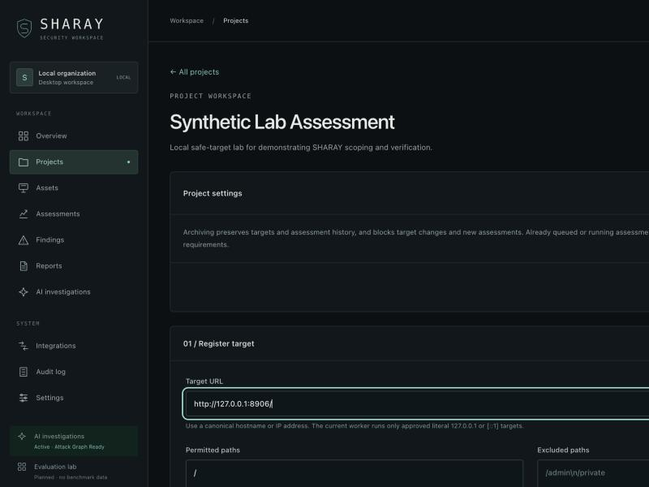
*Figure 4 — Registering a target and its permitted/excluded paths.*

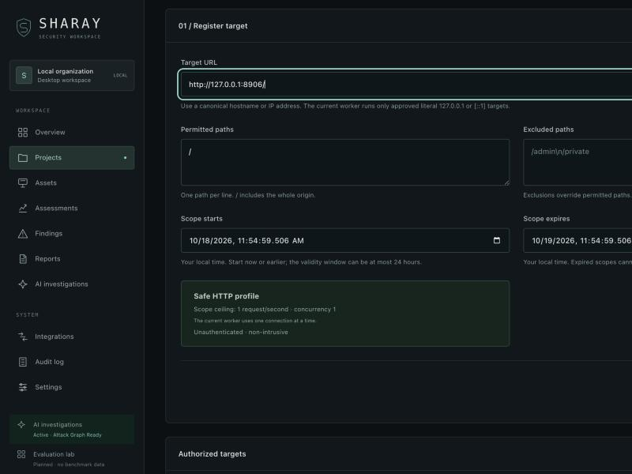
*Figure 5 — The profile's hard ceilings (1 request/second, concurrency 1, unauthenticated, non-intrusive) shown at scope time.*

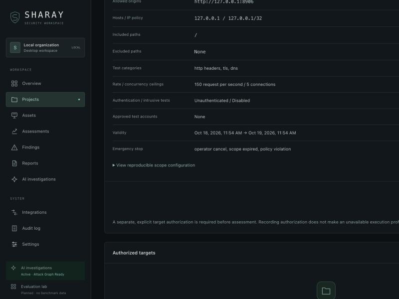
*Figure 6 — The deterministic scope preview the operator must approve.*

---

## 4. The safe HTTP adapter

The in-process adapter (`packages/scanner_adapters/__init__.py`) is the zero-dependency core
that runs even with no containers installed. It is bounded to the bone: **≤5 requests, ≤15
seconds, 3-second per-request timeout, 64 KB header budget, zero response-body retention,
concurrency 1.**

It never uses a DNS resolver during a request — it connects to the policy-selected numeric
address and verifies the connected peer is exactly the pinned IP:

```python
def _connect(destination, timeout) -> _DeadlineSocket:
    address = ipaddress.ip_address(destination.ip)
    sock = _DeadlineSocket(AF_INET6 if address.version == 6 else AF_INET, SOCK_STREAM)
    sock.connect(endpoint)
    if ipaddress.ip_address(sock.getpeername()[0]) != address:
        raise PolicyError("The connected peer does not match the pinned destination.")
    return sock
```

A custom `_DeadlineSocket`/`_DeadlineTLS` enforce a wall-clock deadline on every `recv`, and a
`_HeaderReader` caps total header bytes so a hostile server cannot stream headers forever.

Crucially, the adapter **does not store raw header values** — it distills *configuration facts*.
`_header_facts()` parses security headers into booleans and small enums: whether CSP is
non-empty, whether `frame-ancestors`/`X-Frame-Options` actually restrict framing (respecting
that enforced `frame-ancestors` overrides XFO), nosniff, referrer-policy validity, CORS
wildcard-with-credentials, cookie `Secure`/`HttpOnly`/`SameSite` and `__Host-`/`__Secure-`
prefix correctness, and software-identifier *presence* (never the version string itself). Every
fact carries an explicit `header_analysis_limits` note stating what was *not* tested.

`_findings()` turns those facts into `info`/`low` findings and — importantly — every finding's
description states that "header configuration alone does not establish an exploitable
vulnerability." These are **hardening-posture** items, deliberately separated from exploitable
vulnerabilities in the report (Section 8).

The `scan()` loop re-validates scope and expiry *immediately before every connection*, paces
requests to the approved rate, follows redirects only after re-checking scope, and classifies
its own outcome honestly as `completed` / `completed_with_errors` / `failed` / `cancelled`.

---

## 5. Isolation: rootless containers with single-destination egress

When an external tool (Nuclei, ZAP, Metasploit, Nmap, curl) must run, it runs inside a
locked-down rootless container. `services/scanner_worker/container.py` is written **fail-closed**:
it refuses to run at all when it cannot enforce what it claims.

The baseline runner drops everything:

```python
# build_run_argv() — a no-network, read-only, unprivileged container
return [runtime, "run", "--rm",
    "--network=none",                      # no egress at all
    "--read-only", "--cap-drop=ALL",
    "--security-opt=no-new-privileges",
    "--pids-limit", str(pids_limit),
    "--memory", f"{memory_mb}m", "--cpus", str(cpus),
    "--mount", f"type=bind,src={source},dst=/input,ro",
    "--workdir", "/input", "--env", "HOME=/tmp",
    image, *tool_argv]
```

For a live target, egress must be opened to **exactly one** destination. SHARAY builds an
iptables default-drop allowlist on the podman VM's `FORWARD` chain — permitting new connections
from the container subnet only to `allow_ip:allow_port`, with replies via conntrack, and
dropping *everything else including DNS*:

```python
# build_egress_ruleset() — default-drop, single destination
"up": [
    ["iptables", "-N", chain],
    ["iptables", "-A", chain, "-d", tgt, "-p", "tcp", "--dport", dport, "-j", "ACCEPT"],
    ["iptables", "-A", chain, "-j", "DROP"],      # everything else is dropped
    ["iptables", "-I", "FORWARD", "1", "-s", subnet, "-m", "conntrack",
        "--ctstate", "ESTABLISHED,RELATED", "-j", "ACCEPT"],
    ["iptables", "-I", "FORWARD", "2", "-s", subnet, "-j", chain],
],
```

`run_with_egress()` applies the allowlist *before* the tool starts and tears it down in a
`finally` block *always*, even on timeout — and if teardown fails it demotes an otherwise
successful run to `failed` rather than leave the sandbox network dirty:

```python
clean = result.returncode == 0 and teardown_ok
return IsolatedResult(outcome="completed" if clean else "failed", ...,
    stderr=b"" if teardown_ok else b"egress allowlist teardown failed; … left dirty", ...)
```

Every token that crosses into the VM shell is `shlex.quote`d, so a tool argument like
`x; rm -rf /` can never become a second command. The hostname is pinned in the container's
`/etc/hosts` via `--add-host name:ip` so the tool never needs DNS.

`attest()` reports honestly what the current host can enforce — single-destination egress only
on a podman machine; any other runtime is no-network only. The Integrations page (Figure 13)
renders exactly this, and the module's own docstring is blunt: *"It never claims isolation it
cannot enforce."*

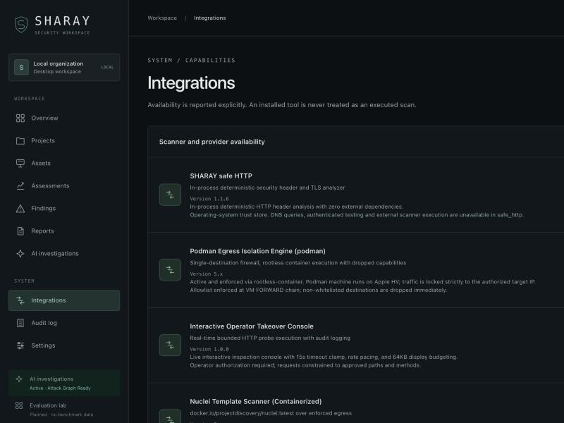
*Figure 13 — Scanner and isolation availability reported explicitly; an installed tool is never treated as an executed scan.*

---

## 6. The assessment pipeline

### 6.1 The worker loop

`aegis/worker.py :: run_one()` claims the oldest queued assessment inside a `BEGIN IMMEDIATE`
transaction, reconstructs the scope and `ScanConfig` from the frozen snapshot, validates the
execution URL (with ownership), and dispatches to the right adapter by profile:

```python
destination = check_execution_url(scope, target_url, owned=owned)
if destination.host in ("127.0.0.1", "::1") and profile == "safe_http":
    result = scan(scope, target_url, cancelled, emit, request_starts=…)
elif profile == "approved_templates":
    result = scan_live_nuclei(destination, resolve_pinned(destination.host), …)
elif profile == "comprehensive":
    result = scan_comprehensive(destination, pinned_ip, mode=mode, tools=tools, …)
else:
    result = scan_live(destination, resolve_pinned(destination.host), run=run_with_egress)
```

### 6.2 Ten stages

`scan_comprehensive()` orchestrates the full audit. Each stage appends honest `check` records
and is individually guarded so one failure degrades coverage rather than crashing the run:

1. **Passive recon & TLS inspection** — cipher/protocol/cert-hash capture.
2. **Asset inventory & DNS intelligence** — real `dig`-style record queries (`dns_scanner.py`),
   subdomain discovery.
3. **Multi-port & service discovery** — native socket probe, optional containerized Nmap with
   strict XML parsing.
4. **HTTP security headers & cookies** — reuses the safe-HTTP fact logic over the egress runner.
5. **In-scope web crawler** — recursive HTML/DOM crawl, form and parameter extraction, exposed
   sensitive-file probing (`.git/HEAD`, `.env`, backups → severity-graded).
6. **Headless DOM & SPA analysis** — source→sink flow tracking for DOM XSS, SPA route discovery.
7. **Schema ingestion** — OpenAPI/Swagger/GraphQL endpoint and parameter synthesis.
8. **Adaptive strategy synthesis** — extracts target intelligence and tailors active tags.
9. **Active testing** — behavioral differential tests, native deep vulnerability fuzzing
   (`vuln_scanner.py`), multi-method body/JSON fuzzing (time-based SQLi, SSTI, NoSQL),
   dual-identity IDOR authorization matrix, AST payload forge.
10. **External engines** — context-adapted Nuclei, OWASP ZAP passive scan, non-destructive
    Metasploit auxiliary/`check` verification — each containerized over locked egress.

Between stages 9 and 10 sits the verification gate (Section 7). Loopback-lab targets skip the
heavy external engines by design and are evaluated by the native scanners plus the reproducer.

### 6.3 Scan configuration

`ScanConfig` (`aegis/schemas.py`) is a strict contract: `mode` ∈ {passive, standard, adaptive,
aggressive}, severities validated against the CVSS set, tags constrained by regex, and a closed
`tools` enum. Passive mode may not select active tools; the request rate *inherits the approved
scope* and is never silently defaulted by an adapter:

```python
def within_scope(self, scope) -> "ScanConfig":
    rate = policy.request_rate if self.rate is None else self.rate
    return self.model_copy(update={"rate": min(rate, 5000.0)})
```

### 6.4 Durable, restart-safe pacing

`PersistentRequestStarts` persists a per-origin cooldown to the `origin_cooldowns` table so that
pacing survives a worker restart. After a reboot it conservatively waits one full cooldown
rather than trusting wall-clock elapsed time — a nice detail that prevents an unintended burst
against a target after a crash.

---

## 7. The verification gate — the heart of SHARAY

### 7.1 Deterministic reproducer

`packages/scanner_adapters/reproducer.py` implements a six-state finding lifecycle
(`OBSERVED → CANDIDATE → REPRODUCED → EXPLOITED → CHAINED → VERIFIED`, with `DEMOTED` as the
sink) and the engine that decides promotion. `verify_finding()` runs **three byte-identical
active replays plus one negative-control probe** with a benign token:

```python
# 3 replays must ALL trip the oracle …
passed_replays = sum(1 for a in attempts if a.matched_oracle)
if passed_replays < self.required_replays:
    return ReproductionResult(state=FindingState.DEMOTED,
        demotion_reason=f"Reproduction flapped: only {passed_replays}/3 replays matched")
# … and the negative control must be SILENT
if ctrl_anomaly:
    return ReproductionResult(state=FindingState.DEMOTED,
        demotion_reason="Negative control fired; probe is non-differentiating (false positive)")
return ReproductionResult(confirmed=True, state=FindingState.REPRODUCED, …)
```

The `DifferentialOracle` scores a response against the baseline using canary reflection, a
≥4-second time delta for blind injection, status change, ≥25 % length shift, and SQL / LFI /
command-execution evidence signatures — requiring a combined score ≥35 to call an anomaly. The
negative control is what kills false positives: if a benign payload produces the "same"
anomaly, the probe is not differentiating and the finding is demoted.

### 7.2 AutoPyVerifier — executable proof

For a reproduced finding, SHARAY *synthesizes a standalone Python script* that re-exploits the
target and asserts on a canary or exploit signature, then runs it in an isolated subprocess
(`services/ai_analysis_worker/autopyverifier.py`). Exit code 0 (non-mock) is independent proof:

```python
def execute_in_sandbox(self, script, timeout_seconds=5) -> dict:
    proc = subprocess.run([sys.executable, "-c", script], capture_output=True,
                          text=True, timeout=timeout_seconds, check=False)
    return {"status": "verified", "returncode": 0, "stdout": …} if proc.returncode == 0 \
        else {"status": "failed", "returncode": proc.returncode, "error": …}
```

The synthesizer is careful about command-injection reflection: it explicitly fails if a canary
was only *reflected as raw input* rather than executed by a shell, so "echoed back" is never
mistaken for "executed."

### 7.3 The gate in the worker

The reproducer/verifier wire directly into the finding's lifecycle in `scan_comprehensive`
(demotion and promotion), and the worker makes the **status decision** canonical:

```python
# aegis/worker.py
def _finding_status(finding) -> str:
    if finding.get("lifecycle_state") == "DEMOTED":            return "demoted"
    if finding.get("status") in ("demoted", "false_positive"): return finding["status"]
    if finding.get("lifecycle_state") == "REPRODUCED" or _autopyverifier_passed(finding):
        return "confirmed"
    return "suspected"
```

`_autopyverifier_passed` requires an *integer* exit code of 0, `mock_mode is False`, and a
non-failure status — so a synthetic/mock assertion can never mint a "confirmed" vulnerability.
The worker separately records *only* real, supplied executions as proof observations, and
its envelope validator rejects any adapter result that is not finite JSON with canonically-keyed
records before anything is persisted.

This is why, in Figure 12, a failed run records **no** findings and the UI warns: *"Review check
coverage before interpreting this as evidence of security."* Absence of findings is never
presented as proof of safety.

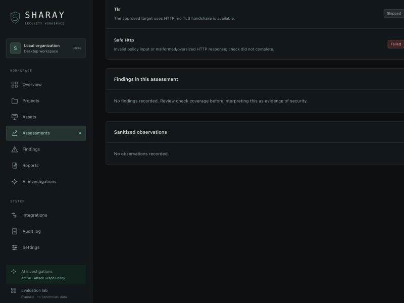
*Figure 12 — Skipped and failed checks are shown explicitly; a failed run yields no findings and an explicit coverage warning.*

---

## 8. Reporting

`packages/reporting/reports.py` renders a completed assessment to PDF, HTML, Markdown or JSON
(`render_report(data, format)`). Its design choices reflect the whole platform's ethos:

- **Partitioning.** Findings are split into verified security vulnerabilities vs. security
  configuration/hardening posture (`_posture`, `_verification`), so a missing HSTS header never
  sits next to a confirmed SQL injection.
- **Redaction at the boundary.** `redact()` scrubs secret-shaped keys and token-shaped values
  from every record before it reaches a report (and before it is even stored — the worker
  redacts observations and findings on write).
- **Protocol-accurate PoCs.** `_poc`, `_reproduction_playbook`, `_verification_oracle` and
  `_console_action` produce copy-pasteable reproductions: `dig +short TXT _dmarc.<domain>` for
  DMARC, `openssl s_client` for TLS, formatted `curl` for HTTP — not raw JSON dumped into a cell.
- **Impact statements.** `_impacts` yields explicit Technical Impact and Business Impact per
  finding; the PDF carries a CWE/CVSS v3.1 matrix.
- **Branding.** `_pdf` tiles a diagonal "sharay by shardul" watermark and a per-page footer
  (`SHARAY | Author: Shardul · https://shardulchaulagain.com`).

Report generation is asynchronous (`POST /reports/{id}` → job → `…/download`), with a cache and
recovery path (`packages/reporting/async_renderer.py`).

---

## 9. The audit ledger

Every consequential action is appended to a **hash-linked** ledger (`aegis/audit.py`). Each
event's hash covers its own content plus the previous event's hash, forming a chain:

```python
def event_digest(event) -> str:
    payload = [event.organization_id, event.actor, event.action, event.resource_id,
               event.detail, event.created_at, event.previous_hash]
    return hashlib.sha256(json.dumps(payload, sort_keys=True, separators=(",", ":")).encode()).hexdigest()

def verify_audit(db) -> bool:
    previous = "0" * 64
    for row in db.scalars(select(AuditEvent).order_by(AuditEvent.id)):
        if row.previous_hash != previous or row.event_hash != event_digest(row):
            return False
        previous = row.event_hash
    return True
```

The Audit page surfaces the whole chain and an integrity badge (Figure 15): project creation,
scope registration, scope approval, assessment queue/start, each scanner event, and the final
outcome, attributed to the acting operator or the worker. The docstring is candid that this is
local tamper-*evidence*, not external tamper-*protection*.

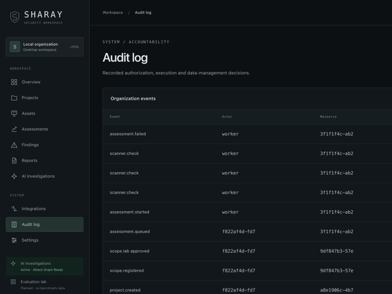
*Figure 15 — The append-only, hash-linked event chain with an integrity badge.*

---

## 10. Identity, RBAC and the human authorization gate

- **No default credentials.** The first owner is created interactively via `init-owner`;
  passwords are ≥12 characters (`aegis/auth.py`, `MemberInput`).
- **Roles.** `owner`, `security_administrator`, `analyst`, `viewer` — the API enforces
  role checks server-side; the UI only *reflects* them.
- **Sessions.** Opaque cookie whose SHA-256 is stored server-side, CSRF token, expiry, with
  brute-force lockout via `LoginAttempt`.
- **Recovery.** The local OS owner can mint a ten-minute, single-use recovery token
  (`issue-recovery` → `reset-password`), which revokes existing sessions. There is no email/MFA
  recovery.

The **operator authorization gate** is the human checkpoint that unlocks live execution. A
target starts `awaiting_authorization`; an operator must review the exact resolved scope and
explicitly record authorization, which flips `verification_status` to `operator_authorized`
(Figure 7). The worker reads that flag as `owned`, and `check_execution_url` refuses live
execution without it.

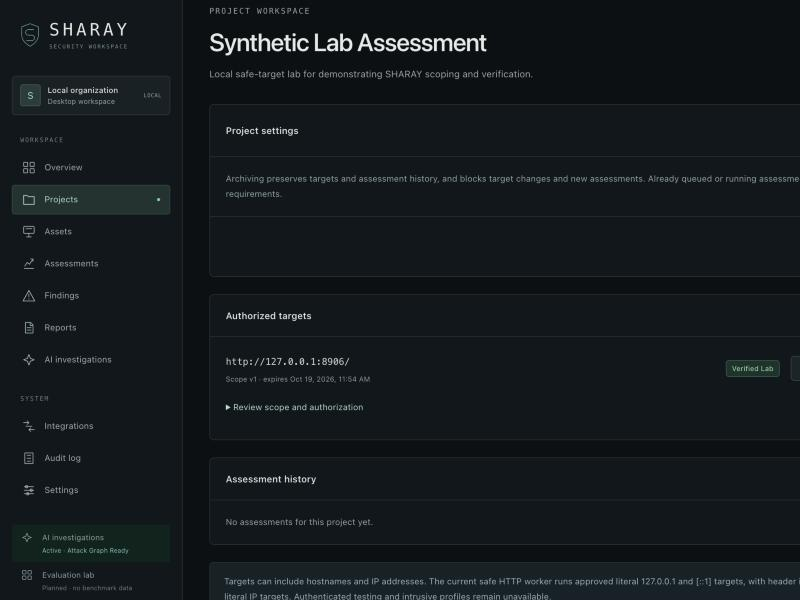
*Figure 7 — A target becomes a "Verified Lab" only after the operator records explicit authorization within the displayed scope and time window.*

---

## 11. AI reasoning layer

The AI layer (`services/ai_analysis_worker/`) is *optional and deterministic by default* — the
attack graph and posture scoring run with no external LLM, and token redaction is enforced on
anything that would be sent to a provider.

- **Formal AND/OR attack graph** (`reasoning.py`). `AttackGraph` ingests observations and
  verified findings into typed nodes/edges and supports noisy-OR confidence propagation over
  AND/OR nodes, `find_attack_paths()` for multi-step kill chains, and a defensive posture score.
- **Min-cut breakpoint analysis.** `BreakpointAnalyzer.find_high_leverage_breakpoints()` finds
  the single edge set whose remediation disconnects the most downstream exploit paths — the
  "fix this one thing first" recommendation.
- **Consensus & entropy escalation** (`autopyverifier.py :: ConsensusSearchEngine`). Best-of-N
  verdict voting with Shannon-entropy gating that escalates ambiguous cases to a frontier model.

The UI (Figure 14) presents the attack-graph DAG, exploit kill chains, root-cause breakdown and
deployable remediation diffs. Stage 11 of the worker constructs and stores the graph; Stage 13
stores a 3D "Maltego-style" topology (Figure 10) linking domain → IP → port → endpoint →
vulnerability.

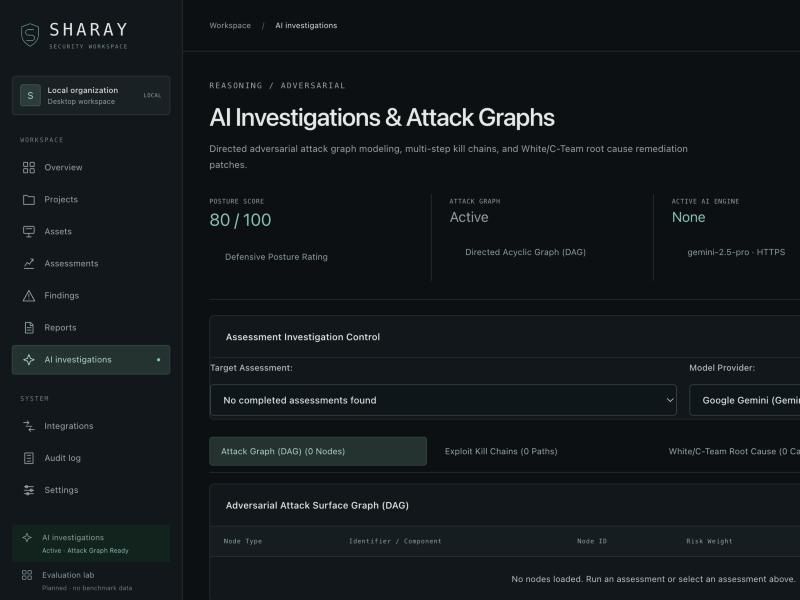
*Figure 14 — Attack-graph DAG, kill chains, and root-cause/remediation tabs; token redaction enforced.*

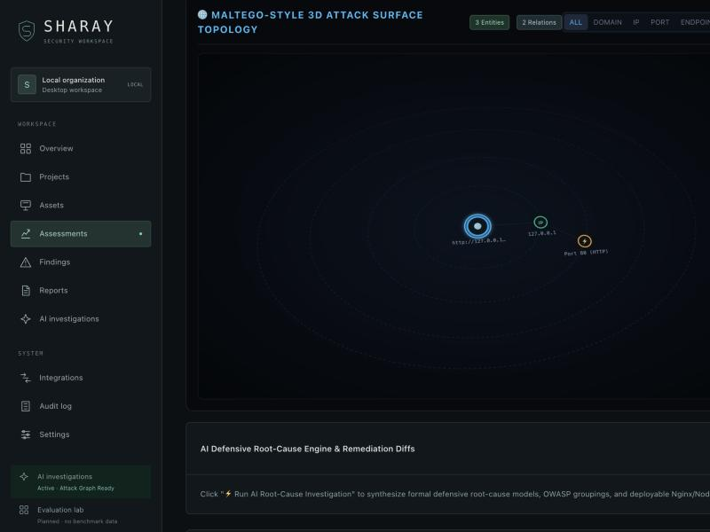
*Figure 10 — The force-directed attack-surface topology built from real observations.*

---

## 12. The interactive operator console

`aegis/interactive.py` + `apps/web/app/terminal.tsx` implement a human-in-the-loop takeover
console. Ownership is a state machine (`HUMAN_OWNED` / `AGENT_OWNED` / `SHARED`): an agent write
is refused while a human owns the console, and any human keystroke preempts an agent.

Commands are **classified and bounded** before execution. The scoped diagnostic verbs are a
closed set — `probe`, `dns`, `ssl`, `beacon`, `http`, `curl`, `retest`, `poc`, `playbook`,
`msf`, `exploit`, `whoami`, `clear`, `help` — each validated against the session's single
authorized target:

```python
if name in {"dns", "ssl"} and parts[1] != target.host:
    raise PolicyError("Only the session target hostname is authorized.")
```

`dns`/`ssl`/`http`/`curl`/`msf`/`exploit` run over the same pinned-IP egress-locked runner as
the pipeline; `retest <id>` queues a fresh 3× reproducer with negative-control canaries; `beacon`
measures target latency and the egress guard. Output is streamed over SSE with a timeout clamp
and display budget, and offensive Metasploit modules are gated behind an explicit exploit-gate
confirmation endpoint and the three-factor safe-gating of Section 13.

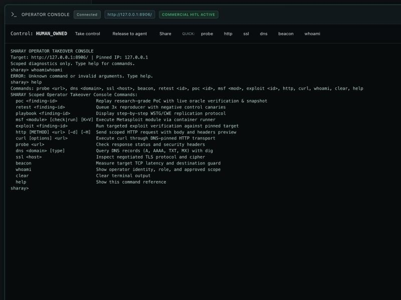
*Figure 16 — The interactive takeover console (HUMAN_OWNED), with its scoped command reference.*

---

## 13. Safe-gated post-exploitation

Worker Stage 14 wires `packages/scanner_adapters/integrations/pivoting.py`: a three-factor
quarantine gate (`SafetyGateValidator`) that stays **quarantined by default** and only arms when
the console is `HUMAN_OWNED`, the scope carries an `ALLOW_ACTIVE_EXPLOIT` signature, and the
operator confirms. It tracks any dropped artifact/canary with a SHA-256 for a one-click clean
exit, and prepares a SOCKS pivot router in standby. In the assessment detail view this renders
as the "PUSHBACK 3-FACTOR SAFETY GATE — QUARANTINED (SAFE DEFAULT)" panel (Figure 11).

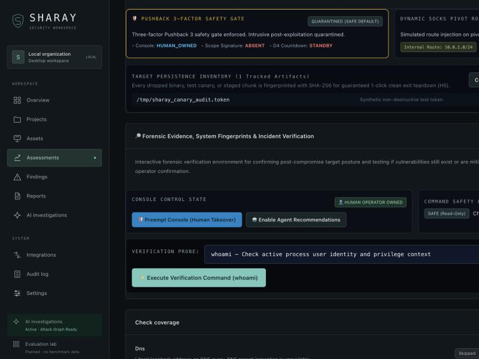
*Figure 11 — Post-exploitation stays quarantined behind a three-factor gate; persistence artifacts are fingerprinted for clean teardown.*

---

## 14. The web workspace

The frontend (`apps/web/`, Next.js static export, no runtime server dependency) is a dark,
focused operator UI. `apps/web/app/workspace.tsx` is the shell; its sidebar routes to Overview,
Projects, Assets, Assessments, Findings, Reports, AI investigations, and the admin pages
Integrations / Audit / Settings. The API client (`apps/web/app/api.ts`) attaches the CSRF token
and dispatches an `aegis-session-expired` event on 401.

The login screen (Figure 1) has no default credentials — if the backend is un-provisioned it
tells the operator to run `init-owner` in a terminal. The Overview (Figure 2) is deliberately
honest: evidence-backed metrics, an "evidence before conclusions" footer, and an empty state
that explains the workflow rather than faking data.

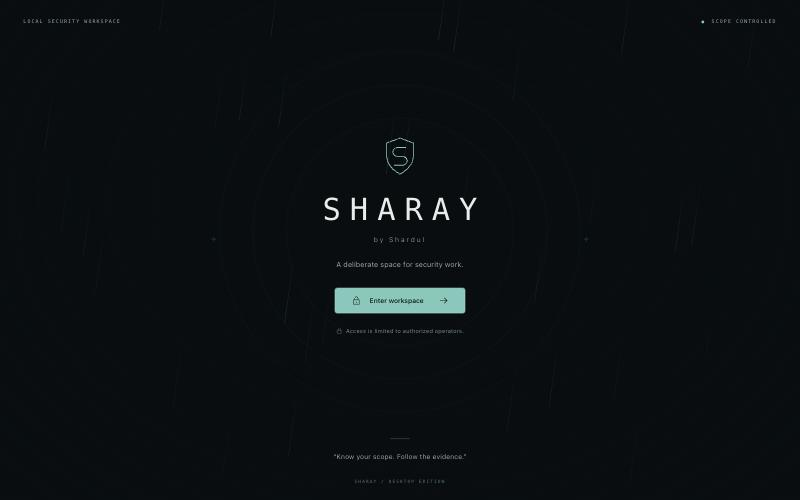
*Figure 1 — The entrance. No default credentials; access is limited to authorized operators.*

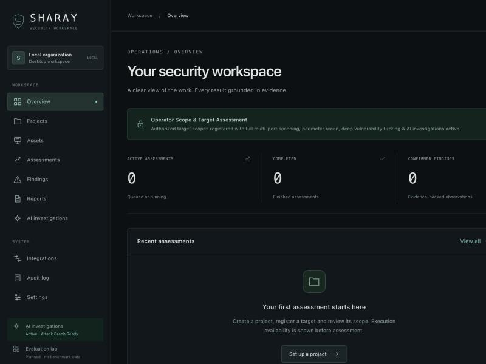
*Figure 2 — The workspace overview: metrics grounded in stored evidence.*

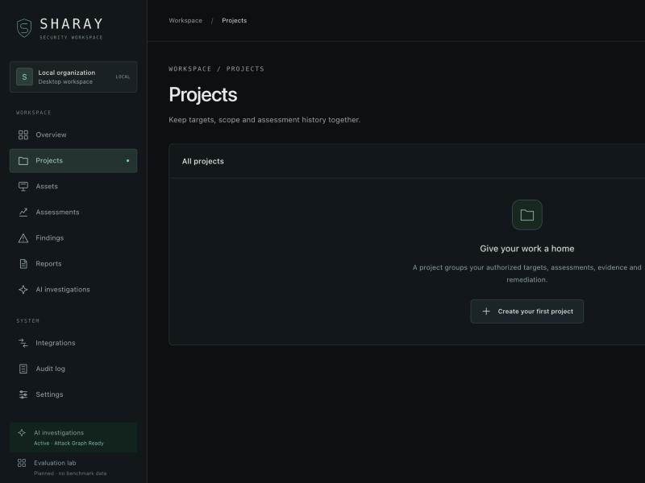
*Figure 3 — Projects group targets, scope and assessment history.*

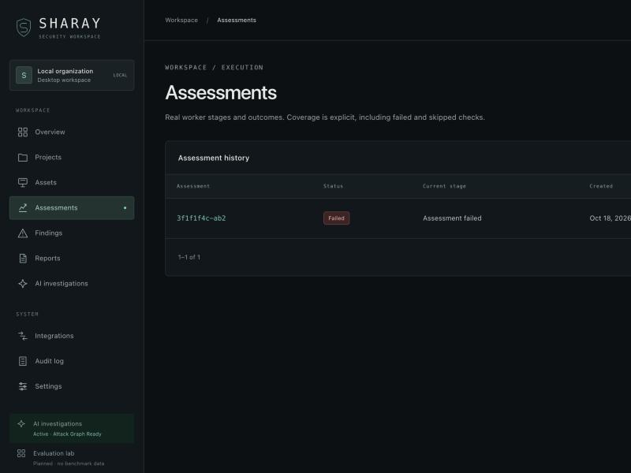
*Figure 8 — Assessment history with explicit outcomes (including failed/cancelled).*

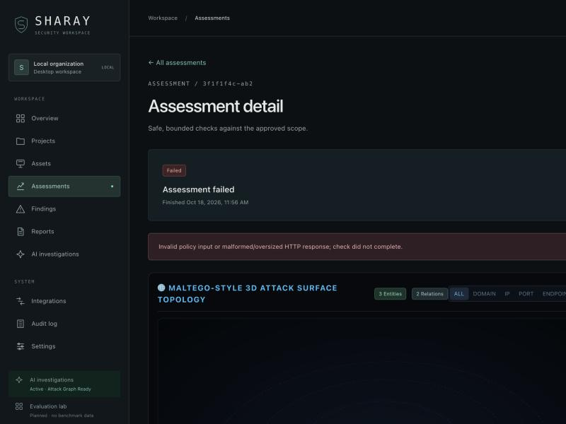
*Figure 9 — An assessment detail honestly reporting a failed run — coverage, not conclusions.*

---

## 15. Why SHARAY is different

1. **Verification is not a feature, it is the architecture.** The reproducer + negative-control
   canary + executable AutoPyVerifier form a gate that the persistence layer enforces; a
   candidate cannot become "confirmed" without surviving a cold replay or producing exit-code-0
   proof.
2. **Honest status everywhere.** Tools that crash are recorded `failed` with the error; skipped
   checks are `skipped`; absence of findings is explicitly *not* a clean bill of health. The
   codebase refuses to mask a non-zero exit as success.
3. **Defense-in-depth on egress.** A typed scope contract, an SSRF-refusing single-IP pin, and a
   fail-closed container egress firewall must *all* agree before a packet reaches a live target.
4. **Auditability by construction.** A hash-linked ledger records every authorization and
   execution decision, and evidence snapshots carry their own hashes.
5. **Local-first and private.** Loopback-only API, private `0700` data dir, zero body retention
   in the safe profile, redaction before storage, and no telemetry.
6. **Protocol-accurate output.** Reports and the console produce the *right* reproduction for
   each protocol, not generic noise.

---

## 16. Limitations (stated plainly)

SHARAY's own documentation and code are candid about boundaries; a faithful paper must be too.

- **Single-destination egress is podman-specific.** The enforced allowlist lives on the podman
  machine's `FORWARD` chain and is **IPv4-only**; on any other runtime the container backend is
  no-network only, and an IPv6 live destination is not yet supported (`container.py`).
- **A truly generic multi-host/CIDR egress allowlist is not built** — callers get exactly one
  destination at a time.
- **The in-process safe profile is loopback-only** and does not do DNS queries, authenticated
  testing, or external scanner execution; those capabilities require the container path.
- **Live execution requires manually-verified ownership** and a public address; by design it
  will not scan private/internal ranges.
- **Authenticated and intrusive testing are off by contract** (`ScopePolicy.authenticated` and
  `.intrusive` are `Literal[False]`); credentialed workflows are not implemented.
- **Concurrency is a single serialized worker.** Throughput is intentionally bounded; there is
  no distributed/parallel scan coordination.
- **The audit ledger is local tamper-evidence, not external tamper-protection** — a local admin
  with DB write access could rewrite the chain; there is no external notarization.
- **Account recovery is local-OS only.** No email, no MFA.
- **Evidence retention is indefinite**; automatic data deletion is not implemented (noted in the
  Settings panel itself).
- **The AI layer's live LLM path is optional and provider-keyed**; without keys the system runs
  deterministically (attack graph, posture, reproducer) and the "active AI engine" reads *None*.
- **Some live adapters are gated as prototypes.** `scan_live()` with no injected runner returns a
  `blocked` result stating that "live execution controls have not passed independent integration
  verification" — honest, but it means the headless live HTTP prototype is not self-serving.
- **Evaluation benchmarks are planned, not populated** — the UI's "Evaluation lab" is explicitly
  labelled *Planned · no benchmark data*.
- **Platform reach.** The native desktop window and the egress backend are developed and tested
  on macOS + the podman machine; Linux portability exists in drafts but is not the tested path.

---

## 17. Reproducing the system

```sh
python3 -m venv .venv
.venv/bin/python -m pip install -r requirements-dev.txt -r requirements-desktop.txt
npm --prefix apps/web ci --ignore-scripts && npm --prefix apps/web run build
.venv/bin/python -m sharay migrate
.venv/bin/python -m sharay init-owner
.venv/bin/python -m sharay desktop          # or: desktop --browser
```

A fully offline demonstration path exists via the synthetic fixture
(`fixtures/safe_targets/server.py` on `127.0.0.1:8766`) and the throwaway QA harness
(`scripts/ui_fixture.py`). The screenshots in this paper were captured against that synthetic
harness with a disposable test account — no real target was scanned.

The product test suite (unit, integration, product, and tool-contract tests) plus ruff/mypy and
the frontend checks are the acceptance gate; see the repository `README.md`.

---

## 18. Conclusion

SHARAY is an argument, made in code, that a security scanner should be **quiet and certain**
rather than loud and probabilistic. By making "a finding is a hypothesis until a cold replay
proves it" the organizing principle — and then building a typed scope boundary, a fail-closed
sandbox, a hash-linked ledger, and protocol-accurate reporting around it — it turns a noisy
category of tool into one whose confirmed output an engineer can act on without re-triaging.
Its limitations are real and, refreshingly, stated by the system itself: bounded throughput, a
podman/IPv4 egress path, loopback-first safety, and planned-but-empty benchmarks. Those are the
edges of an honest tool, and honesty — about what was tested, what failed, and what is merely
configuration — is precisely what SHARAY is built to deliver.

---

*Screenshots are in `docs/research-paper/screenshots/`. All code references point to files in
this repository at the state this paper was written.*
