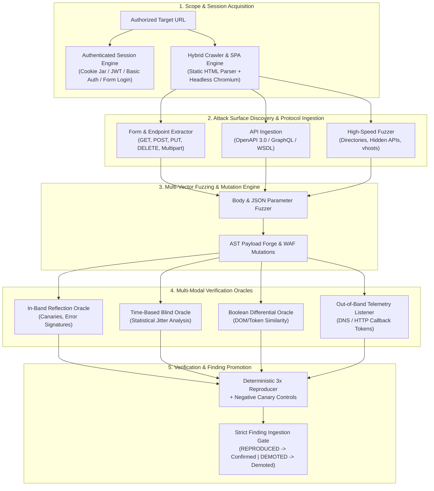

# SHARAY Next-Generation Offensive Scanner & Multi-Engine Penetration Testing Architecture

> **Engineering Specification & Research Blueprint**
> **Author:** Gemini (Senior Technical Lead & Architect)
> **Date:** October 16, 2026
> **Directive:** Eliminate bureaucratic stubs. Build authentic, world-class offensive capabilities with deterministic verification across all attack surfaces.

---

## 1. Executive Codebase Audit: What is Built vs. What is Missing

### Current Built Capabilities (Baseline Established)
1. **Network & Infrastructure Probing**:
   - Native multithreaded TCP port scanner (`port_scanner.py`) scanning 36 standard ports.
   - Passive DNS and DMARC/SPF record verification (`dns_scanner.py`) using native `dig`.
   - TLS handshake, cipher, and certificate inspection (`tls.py`).
   - Rootless container execution and VM bridge egress locking (`services/scanner_worker/container.py`).
2. **Web Crawling & Discovery**:
   - In-scope recursive HTML spider (`crawler.py`) extracting `<a>`, `<form>`, and `<script>` tags up to depth 5.
   - Headless Chromium `--dump-dom` runner (`browser.py`) for single-page application (SPA) dynamic route discovery.
   - Static regex-based DOM sink tracker (`DOMSinkTracker`) for client-side XSS.
   - Sensitive path hunter covering 14 standard files (`/.git/HEAD`, `/.env`, `/backup.sql`, etc.).
3. **Vulnerability Analysis & Verification**:
   - Context-aware adaptive strategy synthesis (`adaptive.py`) mapping tech stacks to Nuclei tags.
   - Basic parameter fuzzing in `vuln_scanner.py` for LFI, Open Redirect, Command Injection, and differential SSRF.
   - Deterministic 3x reproducer with negative-control canary probes (`reproducer.py`).
   - Formal AND/OR attack graph modeling (`reasoning.py`).
   - Strict finding verification gating in `aegis/worker.py` (prohibiting unverified finding confirmation).
   - Scoped operator diagnostic takeover console (`aegis/interactive.py`, `terminal.tsx`).

---

### Critical Offensive Gaps & Structural Weaknesses

Every world-class penetration testing engine (Burp Suite Pro, Invicti, ProjectDiscovery, Metasploit Pro) relies on capabilities that SHARAY currently lacks:

| Critical Gap | Current Codebase Limitation | Real-World Security Assessment Impact |
| :--- | :--- | :--- |
| **1. GET-Only Fuzzing Blindspot** | `vuln_scanner.py` and `crawler.py` strictly send `GET` requests with query strings (`?param=payload`). Zero `POST`, `PUT`, or `PATCH` execution. | Over **80% of critical exploitable vulnerabilities** (SQLi, IDOR, SSRF, Deserialization, RCE) occur in `POST` body parameters or JSON payloads. The scanner is completely blind to state-changing forms, search boxes, login flows, and JSON REST APIs. |
| **2. Lack of Real Authenticated Sessions** | Hardcoded dummy tokens (`Bearer sharay_token_alpha`) and static DVWA cookies (`Cookie: security=low`). | Modern web applications require authenticated sessions (OAuth2, JWT, session cookies). The scanner cannot evaluate internal dashboards, user settings, or role-based access control without automated session acquisition and keep-alive. |
| **3. Missing Blind & Time-Based Injection Oracles** | `vuln_scanner.py` only checks for immediate string reflection in response bodies. | Modern database engines and hardened APIs do not return verbose SQL errors. Without time-based blind SQLi (`pg_sleep()`, `WAITFOR DELAY`), boolean blind differential oracles, and time-based command injection, real SQLi/RCE is missed. |
| **4. Lack of Out-of-Band (OOB) Telemetry** | SSRF verification requires local loopback socket error traces. | True SSRF, blind XXE, blind RCE, and DNS exfiltration do not reflect in the HTTP response. Without an Out-of-Band callback listener (Interactsh / Burp Collaborator paradigm), blind server-side vulnerabilities cannot be proven. |
| **5. Modern API Protocol Blindspot** | Only standard HTML links and basic OpenAPI parsing are supported. | WebSockets (WSS), GraphQL queries/mutations/introspection, and JSON REST bodies are not fuzzed. |
| **6. Multi-Engine Orchestration Gaps** | Nuclei is containerized, but Nmap, ZAP, and Metasploit have minimal integration. Fast wordlist fuzzing (`ffuf`) and database exploitation (`sqlmap`) are completely absent. | Deep content discovery and automated exploit validation are constrained to slow, hand-crafted Python loops instead of dedicated high-performance security engines. |

---

## 2. Architecture for World-Class Offensive Capabilities

---

## 3. High-Priority Engineering Roadmap: Sprint 5 & Sprint 6

### Sprint 5: Multi-Engine Offensive Penetration Testing Suite (P0/P1)

#### 5.1 Request Body & HTTP Method Fuzzing Engine (`body_fuzzer.py`)
- **Form Submission Automation**: Ingest all `<form>` objects discovered by `crawler.py`. Automatically construct `application/x-www-form-urlencoded` and `multipart/form-data` requests with realistic dummy values and active payloads.
- **JSON REST Fuzzer**: Accept arbitrary JSON structures. Recursively walk keys and inject AST payloads into JSON property values (`{"email": "admin' OR 1=1--"}`).
- **HTTP Method Tampering Matrix**: Test endpoints against `GET`, `POST`, `PUT`, `PATCH`, `DELETE`, `OPTIONS`, `TRACE` to discover hidden administrative handlers and bypass method-level access controls.

#### 5.2 Blind & Time-Based Injection Oracles
- **Statistical Time-Based Blind SQLi**:
  - PostgreSQL / MySQL / SQLite / MSSQL / Oracle time delay payloads: `pg_sleep(5)`, `SLEEP(5)`, `WAITFOR DELAY '0:0:5'`.
  - Baseline jitter calibration: Measure 3 baseline request durations ($t_0, t_1, t_2$). Calculate mean $\mu$ and standard deviation $\sigma$.
  - Threshold condition: Finding confirmed if and only if $t_{probe} \ge \mu + 3\sigma + 4.5\text{s}$, reproduced across 3 consecutive trials.
- **Time-Based Command Injection**:
  - Fuzzing vectors: `; sleep 5`, `| sleep 5`, `& sleep 5`, `$(sleep 5)`, `` `sleep 5` ``.

#### 5.3 Server-Side Template Injection (SSTI) & NoSQL Injection
- **SSTI Polyglot Matrix**:
  - Canary evaluation: Inject `{{7*7}}`, `${7*7}`, `#{7*7}`, `<%= 7*7 %>`, `*{{7*7}}`.
  - Detection: Search for evaluated arithmetic result `49` in response body where literal expression was not reflected.
  - Engine identification: Distinguish Jinja2 (`{{config}}`), Twig (`{{_self.env}}`), SpringEL (`${T(java.lang.Runtime)}`), Smarty.
- **NoSQL Injection (MongoDB / CouchDB)**:
  - Query operator injection: `{"username": {"$ne": null}, "password": {"$ne": null}}`.
  - Parameter regex injection: `username[$regex]=.*`.

---

### Sprint 6: Deep Protocol, Authentication & Out-of-Band (OOB) Telemetry Engine (P1)

#### 6.1 Authenticated Session Engine & Multi-Role Access Matrix
- **Configurable Scope Authentication**:
  - Support `auth_config` in `Target.scope`:
    - `bearer_token`: Static or rotating Bearer tokens.
    - `cookies`: Cookie jar string or key-value dictionary.
    - `custom_headers`: API keys (e.g. `X-API-Key`, `Authorization`).
    - `form_login`: Automated login configuration (`login_url`, `username_field`, `password_field`, `username`, `password`, `success_indicator`).
- **Session Health Guard**: Detect session termination (HTTP 401/403 or redirect to login path). Automatically trigger re-authentication without aborting scan.
- **Automated Privilege Escalation & IDOR Sweep**:
  - Test every discovered endpoint simultaneously as:
    1. **Identity A** (Standard User 1)
    2. **Identity B** (Standard User 2)
    3. **Unauthenticated** (Anonymous)
  - Flag any endpoint where Identity B can access Identity A's private resources or perform state-changing operations.

#### 6.2 Out-of-Band (OOB) Telemetry & Callback Listener
- **OOB Verification Paradigm**:
  - Generate cryptographically unique, non-guessable correlation tokens: `sharay-{finding_id[:8]}-{timestamp}.oob.domain.invalid`.
  - Payload injection: Embed token into SSRF, blind XXE, blind command injection, and blind SQLi payloads.
  - Telemetry verification: Ingest callback logs (DNS A/AAAA queries, HTTP GET/POST callbacks). Match correlation token directly to finding for 100% false-positive-free verification.

#### 6.3 Advanced API Security: GraphQL & WebSockets
- **GraphQL Security Analyzer**:
  - Query `__schema { types { name fields { name } } }` for introspection exposure.
  - Test for batch query denial of service (100+ aliases in single request).
  - Deep mutation parameter fuzzing.
- **WebSocket Inspector**:
  - Handshake security: Test Origin validation by spoofing `Origin: https://sharay-attacker.invalid` on WebSocket upgrades (`Upgrade: websocket`).
  - Flag missing origin validation as Cross-Site WebSocket Hijacking (CSWSH).

#### 6.4 Specialized Scanner Integrations (FFuF & SQLMap)
- **High-Speed Wordlist Discovery (`ffuf`)**:
  - Containerized execution of `ffuf` with tuned wordlists for rapid discovery of unlinked directories, configuration backups, and hidden endpoints.
- **Non-Destructive SQLMap Auxiliary**:
  - Execute `sqlmap --batch --risk=1 --level=2 --technique=BEUSTQ` on suspected parameters to produce forensic extraction proofs and database version verification.

---

## 4. Verification & Testing Standards

All additions to this architecture must comply strictly with the project's engineering agreements:
1. **Deterministic Verification Gate**: Every new vulnerability class must implement an explicit `reproducer` method with negative canary controls. No finding may be confirmed on suspicion alone.
2. **Fail-Closed Container Boundary**: External tools (`ffuf`, `sqlmap`, `nuclei`) must execute inside rootless containers strictly bounded by the target's authorized IP over the VM firewall.
3. **Comprehensive Test Suite**: Every module must have 100% hermetic unit and integration tests passing within the 4 engineering gates (`engineering/check.py --run-gates`).
